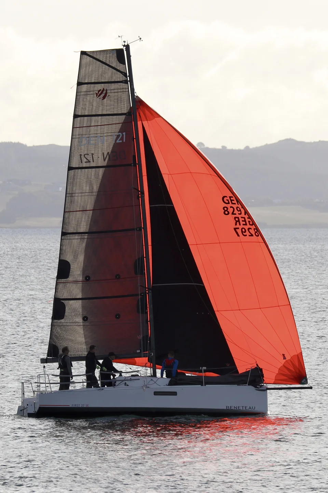

My name is **Casper Lyhne** and I am a sailor and and Engineer from Denmark with an **MSc in Intelligent Autonomous Systems from Aalborg University**. When I am not sailing I tend to spend my evenings learning about sailing. I come at it from a very analytical angle and I love to explore and understand concepts using **simulations** and **data analysis**. This blog is my outlet for that.

I sail a **Beneteau First 27 SE** from **Kaløvig Bådelaug** near Århus, Denmark.

::: {.about-boat}
{fig-alt="My Beneteau First 27 SE sailing with a dark mainsail and a bright red spinnaker." width=960 height=1440}
:::

## Contact

[hummesse@gmail.com](mailto:hummesse@gmail.com)
