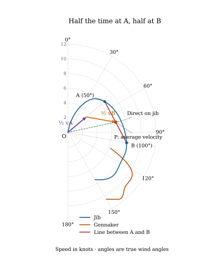

[← All posts](../../index.qmd)

You have your gennaker up and it turns out you can juuuust about lay the next mark while being on the cusp of wiping out. The jib would maybe be almost as fast but you continue anyway - peeling is for whimps. Well is this really the fastest way? Is sailing lower and faster and then switching to the jib in the end to sail much higher to lay the mark better?

Lets get unnecessarily detailed here. Lets start with a fictive polar diagram of a boat with a jib and gennaker. The gennaker is responsible for the part of the polar in the down wind section and the jib is reponsible for the part in the up wind section. At some point they intersect and the sails are equally quick. That is usually around the time where we decide to switch. Let's assume we want to go somewhere that calls for a TWA just at that crossover. This is shown in Figure 1.

.](sail-change-crossover-intro.svg){.compact-figure fig-alt="Blue jib and brown gennaker polars overlap. A green dashed ray marks the desired direction through their crossover at 115.49 degrees TWA. A green dot marks the shared speed of 8.28 knots. No bridge or sailing modes are drawn."}

But there is a conspicuous dent in the combined polar near that crossover. We could sail lower and faster under gennaker for part of the leg, then change to jib and sail higher to lay the mark.

The idea is to find the two sail-and-TWA combinations that make this route as fast as possible. We call those optimal combinations *modes*. So how do we know what the optimal modes are? The polar diagram gives us a way to find that.

## Straight lines give an equivalent polar
First of all, if you pick any two points on a polar and sail first at one point and then at another with some fraction of time between them, then you will sail on an effective polar that is a straight line between them. This is shown in Figure 2.

For example, spend half the time at A and half at B, both on the jib polar. Draw half the velocity at A and half the velocity at B from the origin, then complete the parallelogram with parallel copies of those arrows. Its diagonal gives the average velocity at P, exactly halfway along the straight line from A to B. More generally, spending a fraction $f$ of the time at A gives

$$
\mathbf{v}_{\mathrm{avg}} = f\mathbf{v}_{\mathrm A} + (1-f)\mathbf{v}_{\mathrm B}.
$$

Changing $f$ moves P along that line. These are fractions of **time**, not distance.

.](sail-change-mode-vectors.svg){.compact-figure fig-alt="A close-up of the blue jib polar around A, B, and the vector parallelogram. A purple arrow from the origin shows half the velocity at A on the jib polar. An orange arrow from the origin shows half the velocity at B. Dashed parallel copies complete a parallelogram, whose green diagonal ends at P halfway along the red chord AB. P lies inside the jib polar. A dashed green ray through P reaches the jib curve farther out, showing the higher speed available by sailing directly."}

But here the straight line between the two points is wholly inside the polar, and so it is slower. But any time you can draw a line between two points on the polar that lies outside the polar, it will be faster to switch modes between the two end points of the line. This can only happen if there are dents in the polar. These dents often sit between two sail choices. The optimal modes are endpoints that make the line between them as far outside the normal polar as possible, and that happens if the line is tangential to the polar at both points. This is shown in Figure 3.

.](sail-change-between-sails.svg){.compact-figure fig-alt="Overlapping blue jib and brown gennaker polars. The mark-direction ray passes through their crossover at 115.49 degrees TWA and 8.28 knots. A red bridge joins J at 94.54 degrees to G at 122 degrees. P A lies on the bridge at 9.44 knots, a 13.90 percent gain."}

Sailing the modes is much faster, and the modes are each much more comfortable for each sail. So you will get away from forcing the gennaker too high or feeling under powered under jib. 

Together with the exposed parts of the original curves, the outer bridges form a virtual polar with no dents. Where the boundary follows a sail curve, sail directly; where there are dents sail the modes. If you have the polar available for your boat you can even read the TWA straight off the polar.

## The mode points give the laylines

For the red bridge, the two modes are:

| Mode | TWA | Boat speed |
|---|---:|---:|
| G: gennaker | 122.00° | 10.33 kn |
| J: jib | 94.54° | 7.95 kn |

Draw the jib layline backwards from the mark, at the J heading plus 180°. Sail mode G until reaching that line, then change sail and head directly to the mark in mode J. In steady wind, reversing the order gives the same total time.

Changing the mark direction within this sector changes how long each mode is used, while the two endpoint modes stay fixed. The mark ray meets the bridge at $P_{\mathrm A}$. The distance from J to $P_{\mathrm A}$, divided by the full length JG, gives the fraction of time spent under gennaker.

Here the mark is at the crossover, **115.49° TWA**, where both sails give **8.28 knots** directly toward it. For these polars, this is the worst direct-sailing case within the bridge sector. Switching sails while staying on that heading gives no improvement. We use the gennaker for the direct boat.

Sailing between the modes cuts the sailing time by **about 12%**, despite sailing a little farther.

## Two boats from A to B

Both boats start at A and sail to B. The direct boat holds the gennaker on the crossover heading. The modes boat sails G first, then changes to J at the backward layline from B.

.](sail-change-crossover-leg.svg){fig-alt="A single leg from A to B at the jib-gennaker crossover angle. The direct boat uses the gennaker throughout, at the same speed the jib would give. The modes boat sails below the direct course under gennaker, then heads up under jib to reach B sooner. An inset compares both positions when the modes boat finishes."}

The construction assumes constant wind, settled speed, and no losses when changing mode. A real sail change has to cost less than the time saved. But being able to lay the mark, even with the faster sail for that heading, does not by itself make the direct course quickest.
