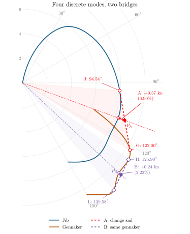
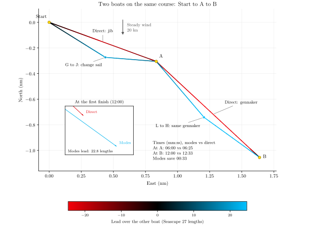

[← All posts](../../index.qmd)

You can lay the mark under jib, and the jib is faster than the gennaker on that heading. It can still be quicker to sail below the mark under gennaker, then change to jib and head up to it.

A sail change takes us between two discrete sailing modes. Here a *mode* means one specific true wind angle (TWA) with a specific sail at a specific true wind speed. It is a single point on a polar. Each sail has a whole polar containing many possible modes; choosing the faster sail at every TWA gives their combined outer curve. That curve can have inward dents.

Across a dent, we can combine two modes and reach the mark sooner than sailing directly toward it with either sail. No wind shift is needed. It is the same idea as tacking or gybing, now between reaching modes.

## Straight lines give an equivalent polar

The figure below uses two fictive sail polars in the same steady 20-knot wind. Blue is the jib and brown is the gennaker. Angle gives TWA; distance from the origin gives boat speed in knots.

.](sail-change-bridge.svg){fig-alt="Overlapping blue jib and brown gennaker polars. A red straight bridge joins J at 94.54 degrees TWA to G at 122 degrees. Its intersection with the mark-direction ray, P A, is 0.57 knots beyond the direct-course polar. A purple bridge joins H and L on the gennaker curve."}

A straight bridge across a dent represents the average velocities achievable by combining its two endpoint modes. Together with the exposed parts of the original curves, these outer bridges form a convex boundary, the **convex hull**. This is an equivalent polar for routes that can combine modes. Its radius in the mark direction gives the best average speed toward that mark.

Spend part of the time in G and the rest in J. Distances add, so the horizontal and vertical speeds on the polar diagram average in the same proportions. Both coordinates vary linearly with the time fraction, which makes the bridge straight. Half the time in each gives the midpoint of GJ. Other time splits trace the rest of that straight segment.

Choose the outer bridge that touches both curves while keeping all available points on the origin side. At smooth contact points, the bridge is tangent to each curve. Where the resulting boundary follows a sail curve, sail directly; where it follows a bridge, combine its endpoints.

## The bridge points give the laylines

For the red bridge, the two modes are:

| Mode | TWA | Boat speed |
|---|---:|---:|
| G: gennaker | 122.00° | 10.33 kn |
| J: jib | 94.54° | 7.95 kn |

These are the layline angles for the two modes. They generally differ from the sail-polar crossover, which only compares the two sails at the same heading.

Draw the jib layline backwards from the mark, at the J heading plus 180°. Sail mode G until reaching that line, then change sail and head directly to the mark in mode J. In steady wind, reversing the order gives the same total time.

Changing the mark direction within this sector changes how long each mode is used, while the two endpoint modes stay fixed. The mark ray meets the bridge at $P_{\mathrm A}$; its position along GJ gives the time split.

In this example the mark is at 110.09° TWA and $P_{\mathrm A}$ is halfway along the bridge. Three minutes in each mode gives an average speed toward the mark of **8.88 knots**, compared with **8.31 knots** directly under jib. The route is slightly longer, 0.91 rather than 0.89 nautical miles, but takes **6:00 instead of 6:25**.

## Two boats around the same course

One boat sails directly toward each mark using the faster sail at that heading. The other combines G and J on the first leg. On the second leg it uses the purple bridge, combining L and H under the same gennaker. Each boat starts the second leg when it reaches A.

.](sail-change-course.svg){fig-alt="Two complete tracks from Start through A to B in steady 20-knot wind. The direct boat uses jib to A and gennaker to B. The modes boat changes from G to J before A, then from L to H before B. A finish inset shows the modes boat ahead by 22.8 boat lengths."}

The construction assumes constant wind, settled speed, and no losses when changing mode. A real sail change has to cost less than the time saved. But being able to lay the mark, even with the faster sail for that heading, does not by itself make the direct course quickest.
