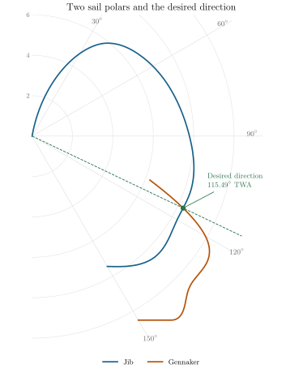
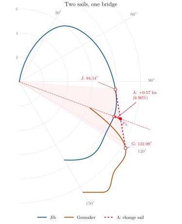
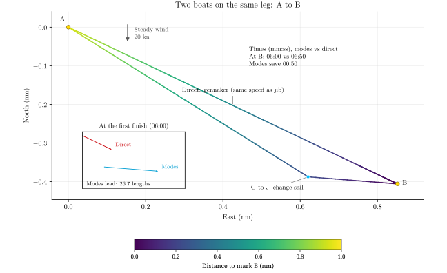

[← All posts](../../index.qmd)

You have your gennaker up and it turns out you can juuuust about lay the next mark while being on the cusp of wiping out. The jib would maybe be almost as fast but you continue anyway - peeling is for whimps. Well is this really the fastest way? Is sailing lower and faster and then switching to the jib in the end to sail much higher to lay the mark better?

Lets get unnecessarily detailed here. Lets start with a fictive polar diagram of a boat with a jib and gennaker. The gennaker is responsible for the part of the polar in the down wind section and the jib is reponsible for the part in the up wind section. At some point they intersect and the sails are equally quick. That is usually around the time where we decide to switch. Let's assume we want to go somewhere that calls for a TWA just at that crossover. This is shown in Figure 1.

.](sail-change-crossover-intro.svg){.compact-figure fig-alt="Blue jib and brown gennaker polars overlap. A green dashed ray marks the desired direction through their crossover at 115.49 degrees TWA. A green dot marks the shared speed of 8.28 knots. No bridge or sailing modes are drawn."}

A sail change takes us between two discrete sailing modes. Here a *mode* means one specific true wind angle (TWA) with a specific sail at a specific true wind speed. It is a single point on a polar. Each sail has a whole polar containing many possible modes; choosing the faster sail at every TWA gives their combined outer curve. That curve can have inward dents.

Across a dent, we can combine two modes and reach the mark sooner than sailing directly toward it with either sail. No wind shift is needed. It is the same idea as tacking or gybing, now between reaching modes.

## Straight lines give an equivalent polar

The figure below uses two fictive sail polars in the same steady 20-knot wind. Blue is the jib and brown is the gennaker. Angle gives TWA; distance from the origin gives boat speed in knots.

.](sail-change-between-sails.svg){.compact-figure fig-alt="Overlapping blue jib and brown gennaker polars. The mark-direction ray passes through their crossover at 115.49 degrees TWA and 8.28 knots. A red bridge joins J at 94.54 degrees to G at 122 degrees. P A lies on the bridge at 9.44 knots, a 13.90 percent gain."}

A straight bridge across a dent represents the average velocities achievable by combining its two endpoint modes. Together with the exposed parts of the original curves, these outer bridges form a convex boundary, the **convex hull**. This is an equivalent polar for routes that can combine modes. Its radius in the mark direction gives the best average speed toward that mark.

Spend part of the time in G and the rest in J. Distances add, so the horizontal and vertical speeds on the polar diagram average in the same proportions. Both coordinates vary linearly with the time fraction, which makes the bridge straight. Half the time in each gives the midpoint of GJ. Other time splits trace the rest of that straight segment.

Choose the outer bridge that touches both curves while keeping all available points on the origin side. At smooth contact points, the bridge is tangent to each curve. Where the resulting boundary follows a sail curve, sail directly; where it follows a bridge, combine its endpoints.

## The bridge points give the laylines

For the red bridge, the two modes are:

| Mode | TWA | Boat speed |
|---|---:|---:|
| G: gennaker | 122.00° | 10.33 kn |
| J: jib | 94.54° | 7.95 kn |

These are the layline angles for the two modes. They generally differ from the sail-polar crossover, which only compares the two sails at the same heading.

Draw the jib layline backwards from the mark, at the J heading plus 180°. Sail mode G until reaching that line, then change sail and head directly to the mark in mode J. In steady wind, reversing the order gives the same total time.

Changing the mark direction within this sector changes how long each mode is used, while the two endpoint modes stay fixed. The mark ray meets the bridge at $P_{\mathrm A}$. The distance from J to $P_{\mathrm A}$, divided by the full length JG, gives the fraction of time spent under gennaker.

Here the mark is at the crossover, **115.49° TWA**, where both sails give **8.28 knots** directly toward it. For these polars, this is the worst direct-sailing case within the bridge sector. Switching sails while staying on that heading gives no improvement. We use the gennaker for the direct boat.

The bridge puts 70.8% of the time in G: about **4:15 under gennaker and 1:45 under jib**. The average speed toward the mark becomes **9.44 knots**, a **13.90%** gain. The route is slightly longer, 0.96 rather than 0.94 nautical miles, but takes **6:00 instead of 6:50**.

## Two boats from A to B

Both boats start at A and sail to B. The direct boat holds the gennaker on the crossover heading. The modes boat sails G first, then changes to J at the backward layline from B.

.](sail-change-crossover-leg.svg){fig-alt="A single leg from A to B at the jib-gennaker crossover angle. The direct boat uses the gennaker throughout, at the same speed the jib would give. The modes boat sails below the direct course under gennaker, then heads up under jib to reach B sooner. An inset compares both positions when the modes boat finishes."}

The construction assumes constant wind, settled speed, and no losses when changing mode. A real sail change has to cost less than the time saved. But being able to lay the mark, even with the faster sail for that heading, does not by itself make the direct course quickest.
