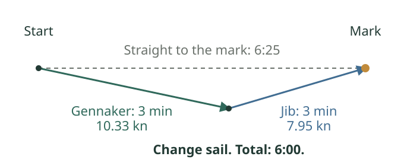

[← All notes](../../index.qmd)

You can lay the next mark with the jib. With the gennaker, you would have to bear away below it. So you leave the gennaker in the bag and sail straight there. Obvious, right?

Sometimes that costs you time.

The jib can comfortably sail the course, but the gennaker may be much faster on a slightly lower heading. You can use that speed for part of the leg, then drop the gennaker and head up under jib to reach the mark. You sail farther, but the extra speed can more than pay for the extra distance.

This is **moding between two sails**. Here, a mode means a particular heading and boat speed with a particular sail, in the same wind. You combine a fast, low gennaker mode with a higher jib mode. The mark lies between their headings, and you choose the change point so the two legs bring you to it.

{fig-alt="A dashed direct route from the start to the mark takes 6 minutes 25 seconds. A longer route goes below it under gennaker for 3 minutes, then heads up under jib for 3 minutes, arriving in 6 minutes."}

In the illustrative example from my pinching and footing note, the gennaker mode makes 10.33 knots and the jib mode 7.95 knots. Three minutes in each gets to the mark in **6:00**, compared with **6:25** sailing straight there with the faster sail for that heading. These are constructed sail polars to show the principle, not measured targets for your boat.

On a polar diagram, the explanation is a straight line. Join the two mode points: that line represents the average velocities you can achieve by splitting your time between them. If it lies outside both sail polars in the mark's direction, combining modes beats the direct course. No wind shift is needed.

To find the change point, draw the higher jib heading backwards from the mark. Sail the lower gennaker heading until you meet that line, then change sails and head for the mark.

The calculation assumes steady wind and no time lost changing sails or accelerating. On the water, the gain has to cover those losses. On a short leg, it may not.

Being able to lay the mark tells you that you can get there. It does not tell you the quickest way.
