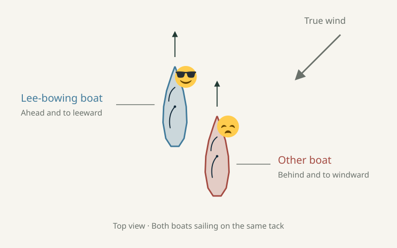
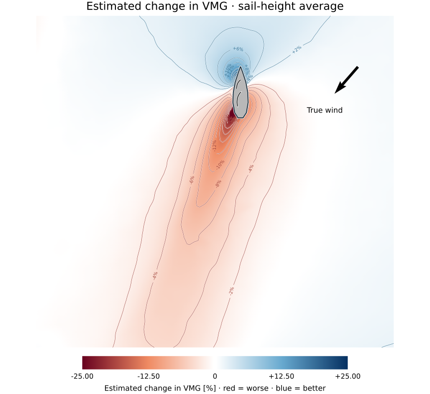
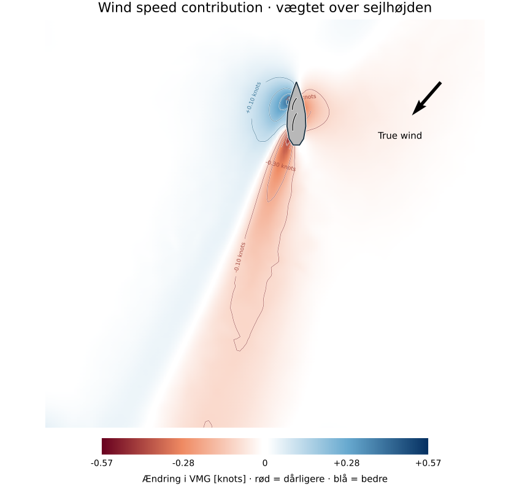
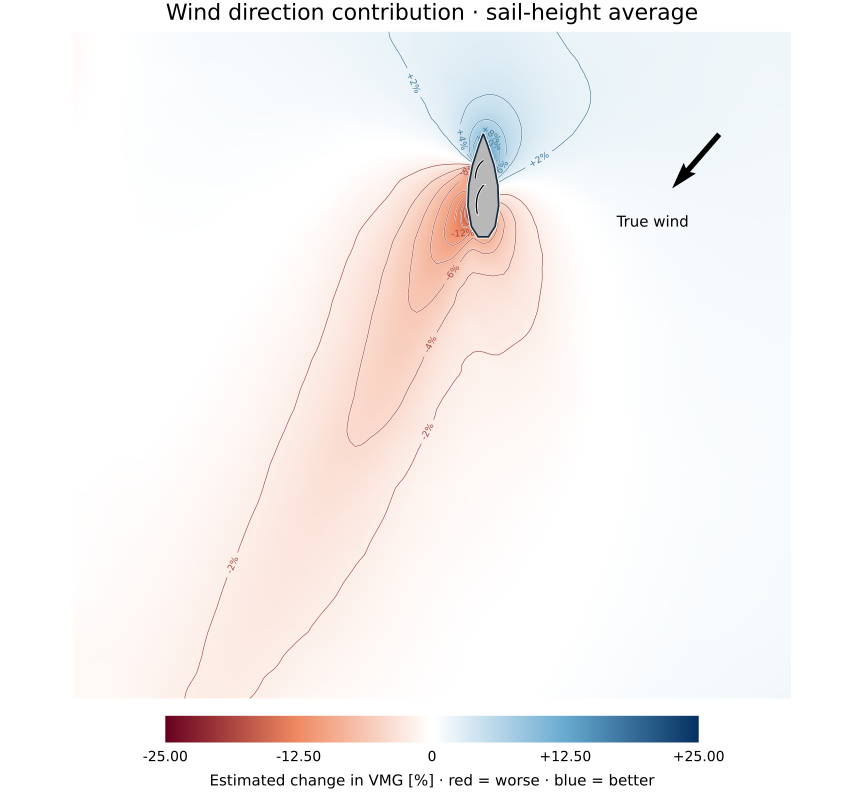
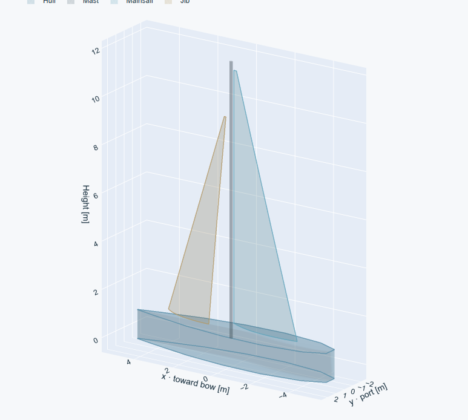
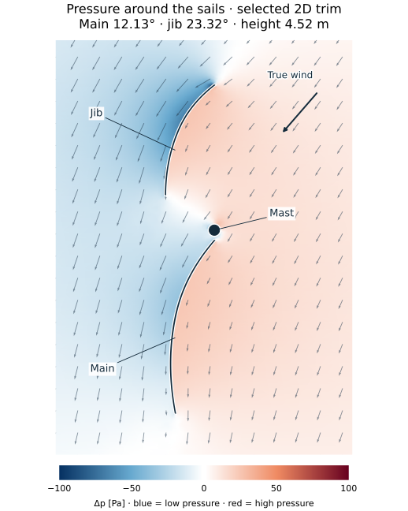
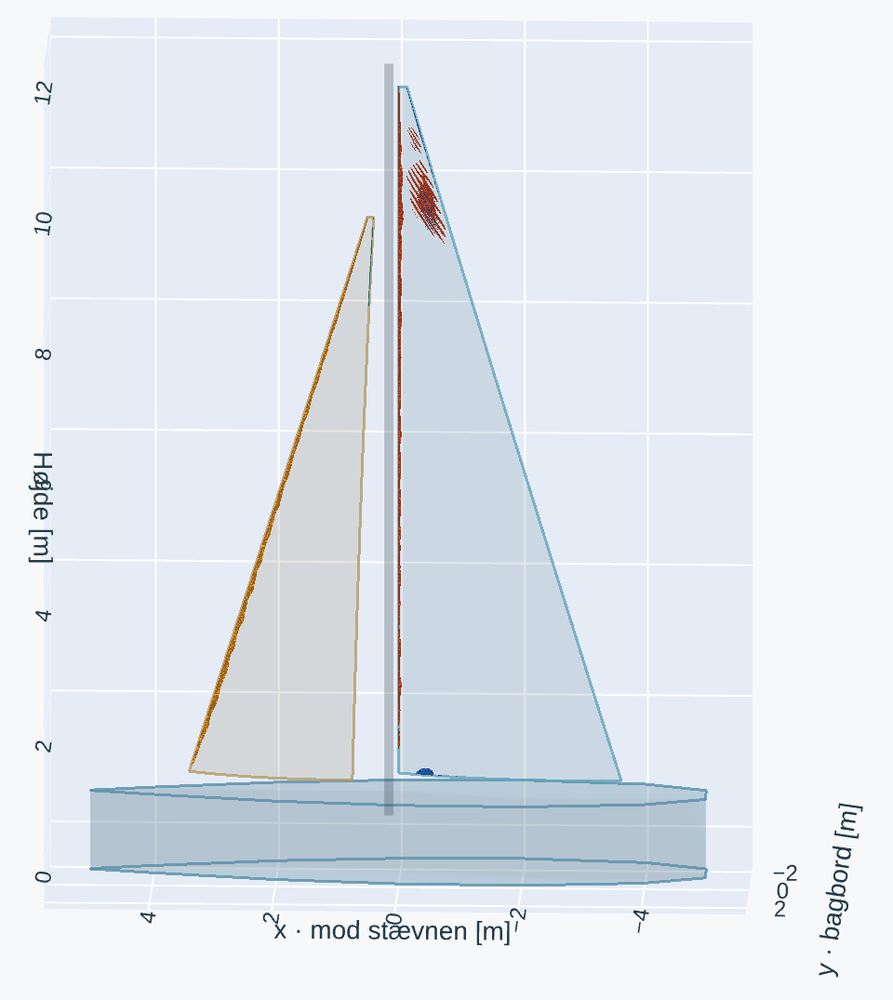
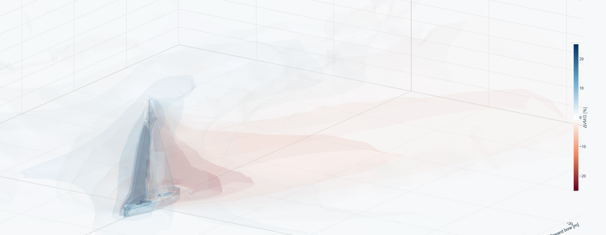

[← All notes](../../index.qmd)

You are a little behind and to windward of a competitor on a beat. You normally sail higher and faster, but somehow you can't roll him. What is going on?
It is well known in the dinghy community that "lee-bowing" someone will help you and hurt the competitor.
Lee-bowing means placing your boat close to the competitor's bow on the lee side.

{#fig-lee-bowing fig-alt="Top view of two boats heading upwards, with true wind coming from the upper right. The blue lee-bowing boat ahead and to the left has a smiling sunglasses face; the red lee-bowed boat behind and to windward has a sad face. Blue means good; red means bad."}

I wondered how this lee-bowing works. Apparently there is supposed to be a weird interaction between the boats in this relative position.
The interaction is supposed to go both ways: negatively for the boat behind to windward and positively for the boat ahead to leeward.
This is completely outside the death ray of getting blanketed by bad air to leeward and behind a boat.

I could not find good quantitative information about this on the web, so I decided to do it myself using AI and some CFD simulations.
It turned out to take more time than I anticipated.

## A boat affects the wind upwind!

After a full 3D CFD simulation with virtual sail trimming and many experiments, the result is the plot below, where you see a rough prediction of lost VMG[^vmg] in percent in the wind field around a boat, averaged over the sail height.

{#fig-combined fig-alt="A boat pointing upwards, with a red wake trailing down and left, red shading to windward, and a blue patch ahead and to leeward. The colour scale is a combined wind-effect metric."}

As you can see, not only do we have the long blanketing effect in the downwind lee of a boat, but the boat is also negatively affecting the wind to windward, and surprisingly, it positively affects the wind in front of the boat, meaning that if there was another boat there, it would benefit from it. Or, in other words, if a boat was lee-bowing it.

So, as a boat is being lee-bowed, it is negatively affected by both the windward lull and the header from the other boat. It is also giving the lee boat more pressure and a lift! At the same time! That is why it is so hard to pass someone close to windward.

Now, what do I mean by percent VMG? That is not a natural output of a CFD simulation.

### Less wind and a worse angle

The combined map contains two effects: a change in wind strength and a change in direction. The maps below show them in their own units, averaged over the sail height: **ΔTWS** is the change in true wind speed in knots, and **ΔTWA** is the change in true wind angle in degrees.

{#fig-speed fig-alt="Sail-height-averaged change in true wind speed in knots. Negative values in red show less wind; positive values in blue show more wind."}

It is clear that, in a wind of around 10 knots, you have to sail through a lull of around 0.4 knots while pushing the boat in the lee bow with an extra 0.6 knots of wind.

{#fig-direction fig-alt="Sail-height-averaged change in true wind angle in degrees. Negative values in red are headers; positive values in blue are lifts."}

At the same time, you will be headed by 2 degrees while lifting the boat ahead by around 3 degrees. That is a 5-degree difference, which will make it impossible to pass!

### Putting the two effects together

To combine knots and degrees, I used a **boat polar**: a table of predicted boat speeds at different wind strengths and angles. It tells us how much a small change in either quantity affects VMG. Here I used an X-332 polar at around 10 knots of true wind and a true wind angle of 41°.[^polar]

Near that point, with the boat holding its course, one extra knot of true wind is worth about **5.95% more VMG**, and a one-degree lift is worth about **0.97% more VMG**. A lull or a header gives the corresponding negative contribution. With ΔTWS in knots and ΔTWA in degrees, the combined score in percent is approximately:

$$
M = 5.95\,\Delta\mathrm{TWS} + 0.972\,\Delta\mathrm{TWA}.
$$

For example, a **0.4-knot lull and a 2° header** contribute about −2.4% and −1.9%, giving a combined score of **−4.3%**. Conversely, **0.6 knots more wind and a 3° lift** give about **+6.5%**. The combined map adds the two contributions at every location, using the same sail-height weighting as the separate maps.

This gives us one scale for comparing the wind disturbances. It is a local estimate based on the polar and gives some indication of the interaction between boats here.

But there is another problem here. A lot of the loss on the map comes from the wind direction changing. If you sail for maximum VMG while being lee-bowed, you will fall down on the other boat. And you have to keep clear. That means sailing higher and slower until you are far enough behind to bear away and pass behind him.

Now it is just a matter of time before you enter the death ray of bad air on his lee stern and fall hopelessly behind.

## Full 3D CFD to simple 2D maps

I used a three-dimensional flow simulation to calculate the steady wind field around the boat.[^solver]
I had to do this because a sail cross-section in 2D completely obstructs the flow, which would exaggerate the effects. In the real world, wind goes around the sails to some extent. The boat model is about 10 m long and 3 m wide, with a mainsail and jib.

{#fig-boat-model fig-alt="An oblique 3D view of a simplified hull and mast with a curved, twisted mainsail and jib."}

The boat sails at 6 knots in 5 m/s of true wind (about 10 knots). The hull stays upright and the sails hold their shape.

There is less wind near the water and more higher up. Combined with the boat's speed, this also changes the apparent wind angle up the rig.

Initially, the models of the sails were very crude and resulted in fully stalled flow.
So I had to make a better sail shape.

### Getting the trim right

To trim the sails I used a camber of 12% and a camber position of 45% of the chord from the leading edge.
This is based on my experience on the water.
I had a look at the wind shear profile and determined that very little twist was needed, so I fixed it at 2°.
The full CFD simulation takes about an hour to run, so it was hard to trim the virtual sails by trial and error.
Instead, I made a 2D CFD simulation of a cross-section of both sails together and iterated on that to find the sheeting angles for both sails that would produce the most combined driving force.

{#fig-trim-2d fig-alt="Close-up of pressure around the simulated main, jib and mast at the selected 2D trim. Blue shows suction and red higher pressure relative to the undisturbed wind, in pascals. Arrows show the solved airflow."}

I then used those sheeting angles for the full 3D CFD simulation and verified that the flow around the sails was somewhat attached.
The orange regions below show air flowing backwards along the sails. They help me identify where there is flow separation.

{#fig-sail-flow fig-alt="Transparent sails with orange reverse-flow regions, including the forward half of the lower mainsail."}

Notice the reverse flow over the forward half of the lower mainsail. I am happy to accept that here: this trim gave the best forward drive in the 2D search. The pattern also looks familiar from real sailing, where I often see reverse flow in that part of the mainsail.

### From 3D to 2D

The resulting wind field is hard to read. Overlapping surfaces obscure each other, making it difficult to judge what another boat would experience.

{#fig-wind-3d fig-alt="The boat surrounded by overlapping translucent red and blue surfaces, coloured using the VMG-based wind-effect metric."}

To make the top-down map at the start of this article, I averaged over the sail height. A boat feels the disturbance across its whole rig, so broad parts of the sails count more than their narrow heads.

I used the polar conversion described above to combine wind strength and direction. Both contributions use the same height weighting, so they add to the combined map.

## Conclusion

So there you have it. I learned a lot about CFD simulations and their limitations, and I learned much more concretely how a boat affects the wind around it.
So a key takeaway is to simply tack if you are too close to a boat and behind on an upwind leg. Even if it is just a short tack, it will be the fastest way to pass. I hope you learned something too.

## Notes {.unnumbered}

[^vmg]: Velocity made good (VMG) is speed towards the windward mark. I use the polar's response to changes in wind speed and angle to put both effects on one percentage scale.

[^solver]: I used [SU2](https://su2code.github.io/) with a steady RANS model and an SST turbulence model. It calculates the mean flow rather than individual gusts. The [simulation code](https://github.com/chlyhne/Onsdagsbanen/tree/main/cfd) is available on GitHub.

[^polar]: The combined percentage scale comes from the [2019 ORC polar for the X-332 XPLORER](https://matbrev.svensksegling.se/Files/ORCPdf/9bf397be-6679-4a24-94c9-f6c397e8d9b1.pdf), evaluated at 5 m/s true wind and 41° true wind angle. Near that point, losing one knot of wind contributes about −5.95 percentage points; a one-degree header contributes about −0.97. See the [polar data](x332-orc-polar.json) and [calculation details](orc-linearisation.json).
